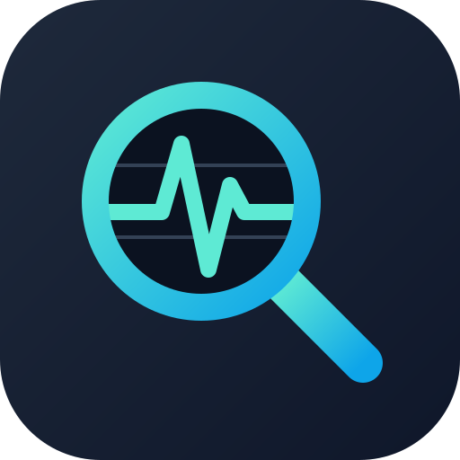

<p align="center">
  
</p>

# observe-lens

[](https://github.com/evrentan/observe-lens/actions/workflows/ci.yml)

Read-only investigation skills for AI agents. They answer "what happened and
why" by reading the systems a change passes through: the CI pipeline that
built it, the CD tool that shipped it, the database that stores its data and
the telemetry it emits. The evidence ends up on one timeline.

They are for anyone who needs that answer:

- **Developers**: the failing call, the error and the line to fix.
- **Testers**: is the failure the change, the environment or a known flake?
- **Analysts and product owners**: a plain-language status, without knowing
  the tools.

The skills never change the systems they read: no reruns, syncs, writes or
silenced alerts. When a change is the right next step, they tell you exactly
what to click or run.

## Skills

| Skill | Answers | Systems |
| --- | --- | --- |
| `observe-lens` | Routes the question to the right areas and merges their findings into one timeline | all of the below |
| `observe-lens-pipelines` | What a build or test run did and why it failed | Jenkins, GitHub Actions |
| `observe-lens-cd` | What is deployed where, since when, and whether it is healthy | Argo CD, Flux, Helm, Kubernetes |
| `observe-lens-db` | What state a record is in | PostgreSQL, MySQL/MariaDB, MongoDB/DocumentDB |
| `observe-lens-telemetry` | What a service logged, which call failed, error rates, alerts | Grafana, Loki, Tempo, Prometheus |

Each area skill also works on its own, so you can install only the ones you
use.

### Example questions

- "Why did build-api #812 fail? Is it my change?"
- "Is commit 3f2a9c1 live in prod yet, and since when?"
- "What did the payments service log for order A-123 around 09:45 UTC?"
- "What status is order 812345 in on shop-dev?"
- "Error rate on checkout went up after this morning's release. What changed?"

## Requirements

- Python 3.11 or newer. The scripts use the standard library only and run on
  macOS, Linux and Windows. On Windows, use `py -3` or `python` wherever this
  README says `python3`.
- Network access to the systems you configure.
- Per area, only if you use it:
  - db: `psql`, `mysql` or `mongosh`, and an OpenSSH client for tunnels
    (built into macOS and Linux, an optional feature on Windows 10+)
  - cd: `kubectl`, `helm` or `flux` for cluster reads (Argo CD needs only
    Python)

## Install

### As a plugin (one command)

| Tool | Command |
| --- | --- |
| Claude Code | `/plugin marketplace add evrentan/observe-lens`, then `/plugin install observe-lens@observe-lens` |
| Devin | `devin plugins install evrentan/observe-lens` |
| OpenAI Codex | `codex plugin marketplace add evrentan/observe-lens`, then install `observe-lens` from `/plugins` |
| Cursor | Customize → Plugins → "From GitHub Repository" → `evrentan/observe-lens` |

Plugin installs namespace the skills, for example
`/observe-lens:observe-lens-db` in Claude Code and Devin.

### Manual install (any tool that reads Agent Skills)

Copy or symlink the folders under `skills/` into your tool's skills folder.
`~/.agents/skills/` is read by Codex, Cursor and Devin; `~/.claude/skills/` is
read by Claude Code.

```bash
# bash/zsh, from a clone of this repo
mkdir -p ~/.agents/skills
cp -R skills/observe-lens* ~/.agents/skills/
# or symlink, so a git pull updates the installed skills
for s in skills/observe-lens*/; do ln -s "$(pwd)/${s%/}" ~/.agents/skills/; done
```

```powershell
# PowerShell, from a clone of this repo
New-Item -ItemType Directory -Force "$HOME\.agents\skills" | Out-Null
Copy-Item -Recurse skills\observe-lens* "$HOME\.agents\skills\"
# or symlink (needs Developer Mode or an elevated prompt)
Get-ChildItem -Directory skills\observe-lens* | ForEach-Object {
  New-Item -ItemType SymbolicLink -Path "$HOME\.agents\skills\$($_.Name)" -Target $_.FullName }
```

## Configure

The skills don't ship with any instances. You describe your own systems once,
and every tool you use reads the same configuration from
`~/.config/observe-lens/<area>/` (override with `OBSERVE_LENS_CONFIG_DIR`).
How you installed the skills doesn't matter.

Run the setup commands **in your own terminal**, from a clone of this repo.
`config add` asks for tokens and passwords with a hidden prompt and refuses
to run without a terminal, so an agent never sees or types a secret.

```bash
# 1. Create the folders and templates for an area
python3 skills/observe-lens-pipelines/scripts/pipelines.py config init

# 2. Add an instance (prompts for its token)
python3 skills/observe-lens-pipelines/scripts/pipelines.py config add ci-main \
  --provider jenkins --url https://jenkins.example.com --set environment=test --default

# 3. Check it: shows where each secret comes from, never the value
python3 skills/observe-lens-pipelines/scripts/pipelines.py config check
```

The other areas work the same way:

```bash
python3 skills/observe-lens-cd/scripts/cd.py config add argocd-prod \
  --provider argocd --url https://argocd.example.com --set environment=prod

python3 skills/observe-lens-telemetry/scripts/telemetry.py config add grafana-prod \
  --provider grafana --url https://grafana.example.com --set environment=prod

python3 skills/observe-lens-db/scripts/db.py config add shop-dev --engine postgres \
  --set host=127.0.0.1 --set port=15432 --set database=shop \
  --set users=shop_ro --set tunnel=dev-bastion --set environment=dev
```

SSH tunnels for databases are defined by editing `db/config.json`. Copy the
`tunnels` block from `db/config.example.json`, which `config init` places next
to it.

Tokens can also come from environment variables or your OS secret store
(macOS Keychain, `secret-tool`, `pass`, 1Password, PowerShell
SecretManagement) instead of a file. See
[`skills/observe-lens/references/config.md`](skills/observe-lens/references/config.md)
for the full layout, the secret lookup order and per-OS examples. Each area's
`references/setup.md` lists the fields and the minimal token permissions.

### Knowledge notes: teach it your systems

Each area has a `knowledge/` folder for Markdown that **you** write: job names
and how they chain, app and environment names, schemas and key tables, log
label names, id formats, known flaky tests. The skills read these notes before
writing a query, which is how generic tooling learns your organisation.
`config init` adds a template with prompts to fill in. Short and specific
beats long. Keep secrets out of these notes.

### Trying the scripts yourself

Once configured, the scripts the agent uses are plain CLI tools:

```bash
python3 skills/observe-lens-pipelines/scripts/pipelines.py run TEAM/api 812
python3 skills/observe-lens-cd/scripts/cd.py app shop-api
python3 skills/observe-lens-cd/scripts/kube_ro.py kubectl get pods -n shop
python3 skills/observe-lens-db/scripts/tunnel.py start dev-bastion
python3 skills/observe-lens-db/scripts/db.py query "select id, status from orders where id = 812345"
python3 skills/observe-lens-telemetry/scripts/telemetry.py logs '{namespace="shop"} |= "error"' --from now-15m
```

## Security model

observe-lens handles credentials and can read production data, so it's
built to be safe by default. The scripts are a second layer of protection;
**read-only database users and read-only (Viewer) API tokens are the first.**

- **Reads only.**
  - HTTP calls are GET only, and raw `get` commands accept only read paths.
    This blocks the GET endpoints that do change state: Jenkins token
    triggers, Argo CD `refresh`, and Loki or Tempo `flush`/`shutdown`.
  - SQL must be a single SELECT-style statement and runs in a read-only
    transaction.
  - MongoDB expressions are limited to a fixed set of read calls.
  - `kube_ro.py` runs only read verbs for kubectl, helm and flux.
- **Credentials stay with the scripts.**
  - Secrets are never put on a command line and never printed.
  - Tokens aren't forwarded when a server redirects to another host.
  - kubectl, helm and flux can't be pointed at another API server or
    impersonate another user.
  - Sending a token over plain `http://` to a remote host prints a warning.
- **Leaked secrets are masked.** Tokens, keys, JWTs and password values found
  in logs, test reports, database rows and cluster output are replaced with
  `[REDACTED:<kind>]` before the agent sees them.
- **Production needs `--prod`.** Scripts refuse instances whose environment
  is `prod`/`production`/`prd`/`live` unless the command includes `--prod`,
  which the agent adds only after you say yes (once per session). The flag
  never relaxes the read-only guards. Set `"confirm": true` or `false` on an
  instance to override the environment.
- **Bounded queries.** Default row and line limits apply, and log or trace
  windows longer than 24 hours need an explicit `--wide`.
- **Private temp files.** Downloaded logs and artifacts go to a per-user
  folder that only you can read.
- **Content is data, not instructions.** The skills tell the agent to ignore
  instructions that appear in logs, commits or database rows, and to report
  them to you instead.

Found a vulnerability? Please report it privately, as described in
[`SECURITY.md`](SECURITY.md).

## Extending

- New CI or telemetry backends: see `references/adding-a-provider.md` in
  `observe-lens-pipelines` (GitLab CI, Azure Pipelines, CircleCI) and
  `observe-lens-telemetry` (Elasticsearch/OpenSearch, Datadog, CloudWatch,
  Jaeger).
- Development:
  - `common/_ol_common.py` is the single source of the shared helpers. Edit
    it there, then run `python3 tools/sync_common.py` to copy it into each
    skill.
  - Install the test tooling:
    `python -m pip install --require-hashes -r requirements-dev.txt`
  - Before a pull request, run:
    - `python3 tools/sync_common.py --check`
    - `python3 tools/validate_skills.py`
    - `python -m pytest`
    - `complexipy common/_ol_common.py skills/observe-lens-pipelines/scripts skills/observe-lens-cd/scripts skills/observe-lens-db/scripts skills/observe-lens-telemetry/scripts tools tests --max-complexity-allowed 15 --failed --plain`

  CI runs the same checks on Linux, macOS and Windows. See
  [`CONTRIBUTING.md`](CONTRIBUTING.md) for the full guide and
  [`CHANGELOG.md`](CHANGELOG.md) for release notes.

## License

Apache-2.0. See [`LICENSE`](LICENSE).
